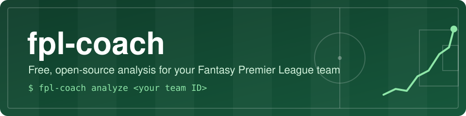
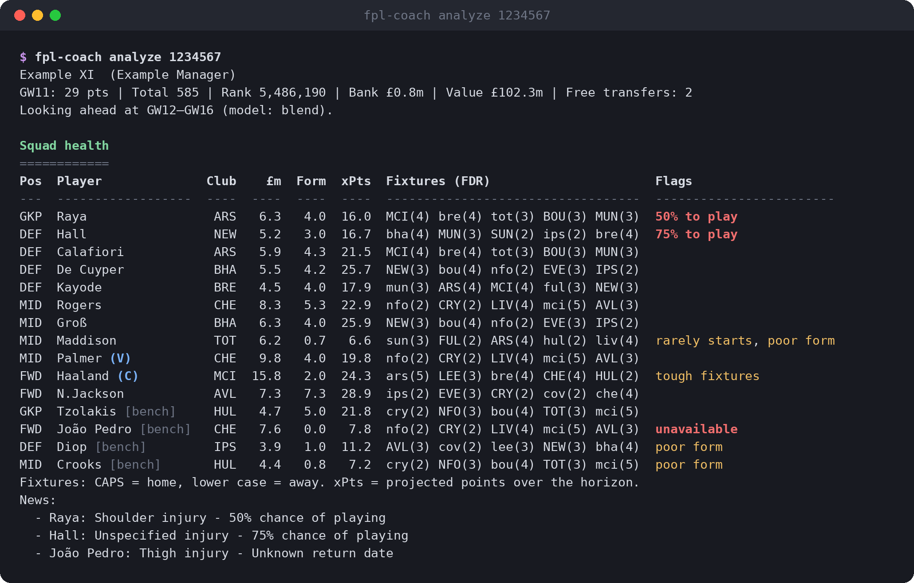
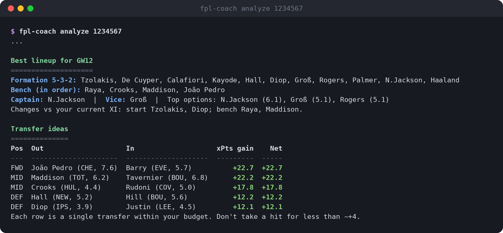
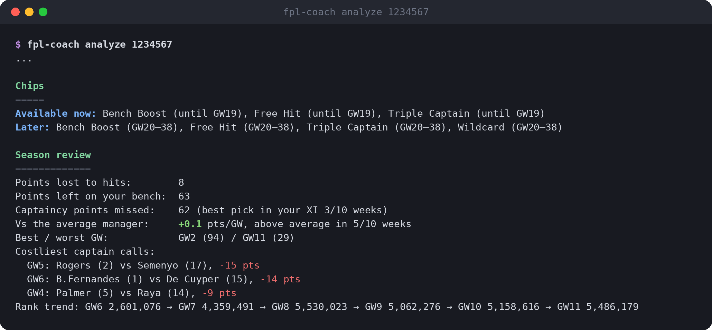
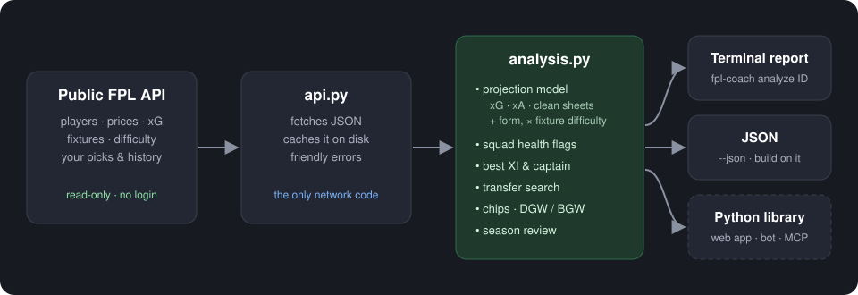
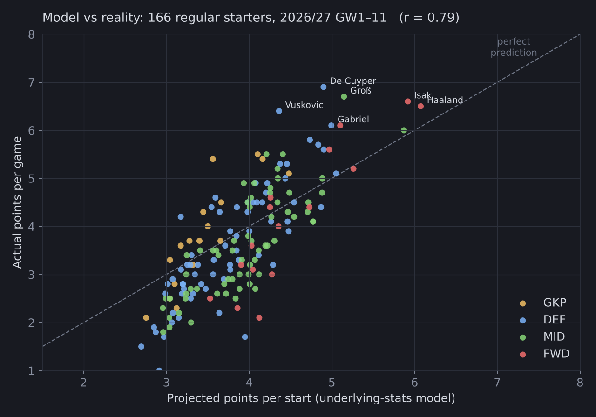

<p align="center">
  
</p>

<p align="center">
  <a href="https://github.com/davidchands/fpl-coach/actions/workflows/tests.yml"></a>
  
  
  <a href="LICENSE"></a>
</p>

<p align="center">
  <b>Type in your team ID and get a full report:</b> who to transfer, who to captain, when to play your chips, and where you've been losing points.<br>
  No login. No password. No sign-up.
</p>

---

## Contents

- [What you get](#what-you-get)
- [Quick start](#quick-start)
- [Options](#options)
- [How it works](#how-it-works)
- [How accurate is it?](#how-accurate-is-it)
- [Use it in your own code](#use-it-in-your-own-code)
- [FAQ](#faq)
- [Roadmap](#roadmap) · [Contributing](#contributing) · [License](#license)

---

## What you get

### 1. Squad health check
Every player in your 15 rated: form, the next five fixtures with difficulty, projected points, and a warning for anything that should worry you (injuries, players who rarely start, poor form, tough runs, blank gameweeks).



### 2. Best lineup, captain and transfers
The highest-scoring XI you can field next gameweek, your bench order and captain options. It also searches every player in the game for the best transfers within your budget and the 3-per-club rule, and accounts for the -4 if you don't have a free transfer.



### 3. Chips and season review
Which chips you still have and when they expire, upcoming double and blank gameweeks, and an honest look back: points lost to hits, points left on your bench, and your costliest captain calls.



> Screenshots are from a real 2026/27 team after Gameweek 11, anonymised.

---

## Quick start

**1. Install** (Python 3.10 or newer, nothing else needed):

```bash
pip install git+https://github.com/davidchands/fpl-coach.git
```

**2. Find your team ID.** Log in at [fantasy.premierleague.com](https://fantasy.premierleague.com), click **Points**, and look at the address bar:

```
https://fantasy.premierleague.com/entry/1234567/event/11
                                        ^^^^^^^
                                        your team ID
```

**3. Run it:**

```bash
fpl-coach analyze 1234567
```

That's it. The first run takes a few seconds while it downloads your season. After that, data is cached for 10 minutes.

---

## Options

| Option | What it does |
|---|---|
| `--horizon 6` | How many gameweeks to look ahead (default **5**) |
| `--free-transfers 2` | Your free transfers. Estimated from your history if you leave it out |
| `--bank 1.5` | Money in the bank in £m. Read from FPL if you leave it out |
| `--model xg` | Projection model: `blend` (default), `xg` or `form`. See [How it works](#how-it-works) |
| `--no-review` | Skip the season review (much faster, fewer requests) |
| `--json` | Print everything as JSON, to feed your own tools |
| `--no-cache` | Ignore the cache and fetch fresh data |

Examples:

```bash
fpl-coach analyze 1234567 --horizon 8          # plan further ahead
fpl-coach analyze 1234567 --free-transfers 3   # you know better than the estimate
fpl-coach analyze 1234567 --json > report.json # save the full report
```

---

## How it works



fpl-coach only **reads** public data from the official FPL API: the same data the FPL website shows you. It never asks for a login and can't change your team.

### Projected points

Every upcoming fixture is scored by two models, blended **60% / 40%**:

1. **Underlying stats.** What a player *should* score based on his expected goals (xG), expected assists (xA), his team's chance of a clean sheet, saves and defensive contributions, scored with FPL's own scoring rules. This sees through luck: a striker with lots of chances but no goals is rated as dangerous, not out of form.
2. **Recent output.** What he *has* been scoring: form and points per game.

Both are adjusted for the opponent's difficulty and for how often the player actually starts. Double gameweeks count twice, blank gameweeks score zero, and injured players are assumed to recover over the following weeks according to their chance of playing.

<details>
<summary><b>Show the exact formula</b></summary>

For one start against an opponent with difficulty rating `FDR`:

```
  2                                              appearance
+ xG/90  × goal points (GK 10 · DEF 6 · MID 5 · FWD 4) × attack factor(FDR)
+ xA/90  × 3                                     × attack factor(FDR)
+ clean-sheet points × P(0 goals conceded)       conceded ~ Poisson(xGC/90 × defence factor(FDR))
− E[goals conceded ÷ 2]                          GK and DEF
+ (saves/90 − 1) ÷ 3                             GK
+ 2 × P(defensive actions ≥ 10 DEF / 12 MID·FWD) actions ~ Poisson(per-90 rate)
+ bonus points per start
```

| FDR | 1 | 2 | 3 | 4 | 5 |
|---|---|---|---|---|---|
| attack factor | 1.25 | 1.12 | 1.00 | 0.85 | 0.70 |
| defence factor | 0.75 | 0.88 | 1.00 | 1.15 | 1.30 |

Two corrections keep it honest:
- **Small samples are shrunk** towards the average for the position (worth about 5 full games), so one lucky cameo doesn't top the rankings.
- **Rates are scaled by real minutes per start**, because attackers are often subbed off around the hour mark.

The scoring values are read from the game itself, so if FPL changes the rules the model follows automatically.
</details>

---

## How accurate is it?



For the 166 players who have started at least 8 games this season, the underlying-stats model's prediction lines up with what they actually scored with a **correlation of 0.79**. Points above the dashed line are players outscoring their underlying numbers (often because of a hot streak that may not last). Points below it are players who've been unlucky.

It's a solid baseline, not a crystal ball:
- It runs about **0.3 points high for midfielders and forwards**, because yellow cards and early substitutions aren't modelled yet.
- It runs slightly **low for goalkeepers**, because penalty saves aren't modelled.
- Fixture difficulty comes from FPL's own 1–5 ratings, not a proper team-strength model.

Use it as a second opinion, not a replacement for watching the games.

---

## Use it in your own code

Everything the CLI shows is available as plain Python dicts, so you can build a web app, Discord bot or AI assistant on top:

```python
from fpl_coach import FPLClient, analyze_team

report = analyze_team(FPLClient(), 1234567, horizon=5)

print(report["lineup"]["captain"])          # the suggested captain
for move in report["transfers"][:3]:
    print(move["out"], "→", move["into"], f"+{move['gain']} pts")
```

Or from the command line: `fpl-coach analyze 1234567 --json`.

---

## FAQ

**Is it safe? Does it need my password?**
No password, no login, nothing to sign in to. Your team ID is public: anyone can already see your team on the FPL website with it. fpl-coach can only read data and cannot make transfers for you.

**Why does the free-transfer number look wrong?**
FPL doesn't publish it without a login, so fpl-coach works it out from your transfer history (+1 per week, up to 5 saved, no new one in a Wildcard or Free Hit week). Special cases like extra transfers handed out mid-season can throw it off, so pass `--free-transfers` to set it yourself.

**Why are selling prices sometimes off?**
Your real selling price (after price rises) also needs a login, so current prices are used. You may have slightly less money than the tool thinks.

**It says "The FPL API is unavailable".**
FPL switches off its API while it updates between gameweeks. Try again in an hour or two.

---

## Roadmap

- [x] Squad health, lineup, captaincy, transfers, chips, season review
- [x] Underlying-stats model (xG, xA, clean sheets, saves, defensive contributions)
- [ ] Team attack/defence strength instead of FDR, minutes prediction, cards
- [ ] Two-transfer and wildcard optimiser
- [ ] Mini-league comparison and effective ownership
- [ ] Web app: paste your ID, get the report in your browser
- [ ] MCP server, so Claude and other AI assistants can analyse your team

Ideas and requests are welcome in [Issues](https://github.com/davidchands/fpl-coach/issues).

---

## Contributing

Pull requests are very welcome, especially better projection models.

```bash
git clone https://github.com/davidchands/fpl-coach.git
cd fpl-coach
pip install -e ".[dev]"
pytest
```

The project is small on purpose:

| File | What's in it |
|---|---|
| `fpl_coach/api.py` | The only code that touches the network: fetching and caching |
| `fpl_coach/analysis.py` | All the football logic, as pure functions: easy to test |
| `fpl_coach/coach.py` | Glues them together into one report |
| `fpl_coach/report.py` · `cli.py` | Terminal output and command-line options |
| `tests/` | A fake season that never calls the real API |

To refresh the README screenshots: `fpl-coach analyze <id> | python docs/render_terminal.py docs/images/report.png`.

---

## License

[MIT](LICENSE), free to use, change and share.

fpl-coach is a fan project and is not affiliated with the Premier League or Fantasy Premier League. The FPL API is unofficial and may change without notice.
