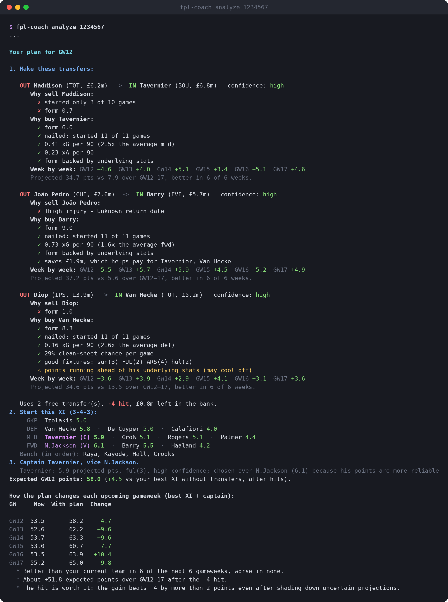
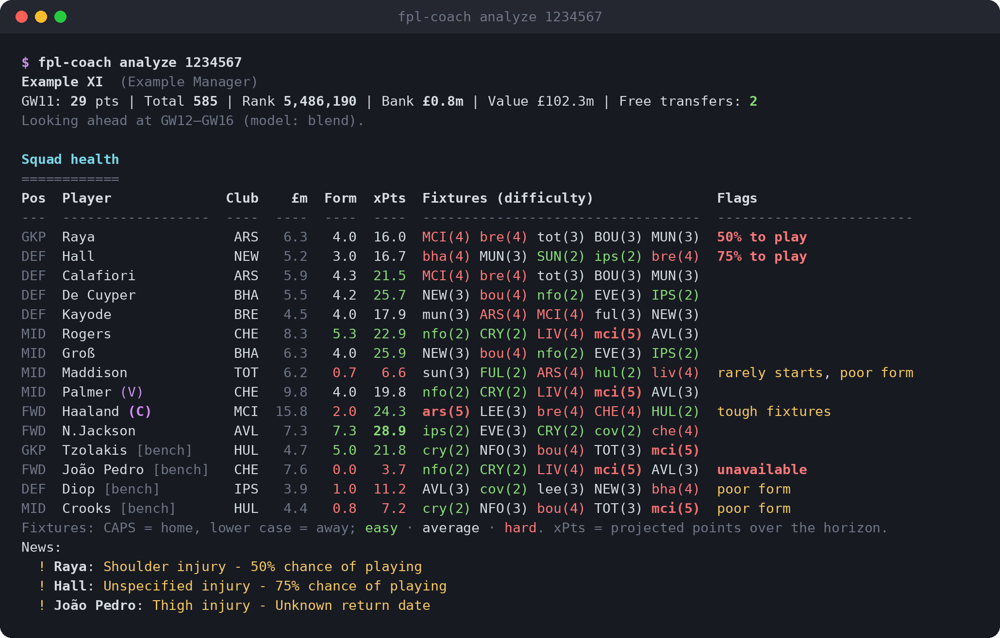
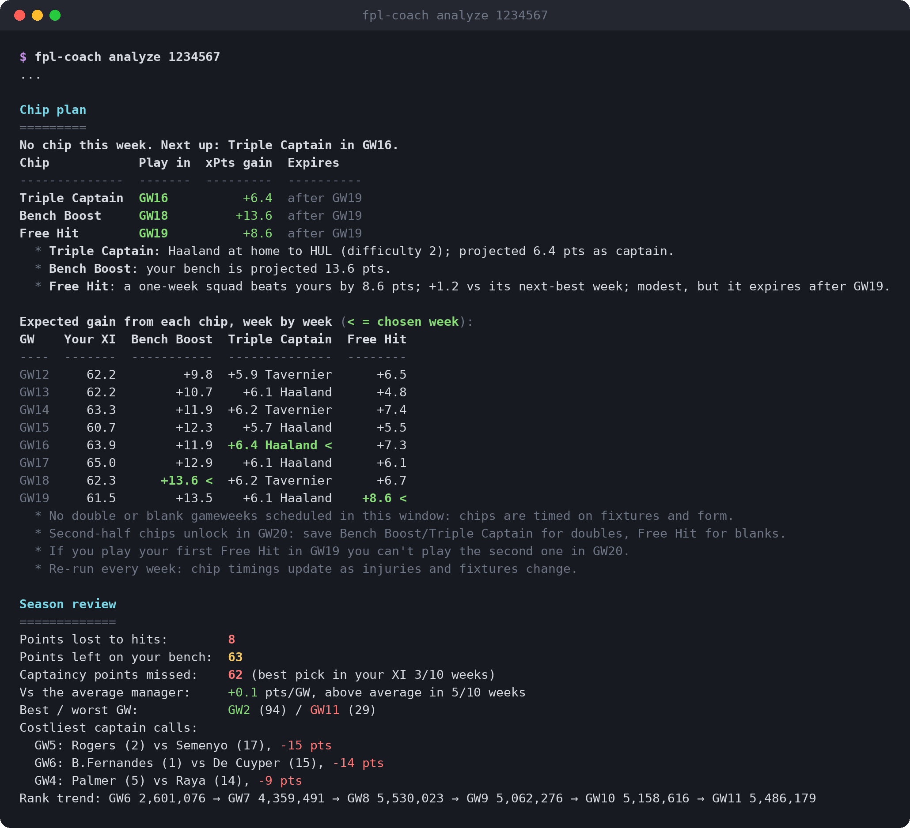

<p align="center">
  
</p>

<p align="center">
  <a href="https://github.com/davidchands/fpl-coach/actions/workflows/tests.yml"></a>
  
  
  <a href="LICENSE"></a>
</p>

<p align="center">
  <b>Type in your team ID and get a full report:</b> which transfers to make, who to start and captain, when to play each chip, and where you've been losing points.<br>
  No login. No password. No sign-up.
</p>

---

## Contents

- [What you get](#what-you-get)
- [Quick start](#quick-start)
- [Options](#options)
- [How it works](#how-it-works)
- [How accurate is it?](#how-accurate-is-it)
- [Use it in your own code](#use-it-in-your-own-code)
- [FAQ](#faq)
- [Roadmap](#roadmap) · [Contributing](#contributing) · [License](#license)

---

## What you get

### 1. Your plan for next gameweek, with reasons
A complete, ready-to-copy plan: **which transfers to make, who to start, the bench order and who to captain**, and **why**.

Every transfer comes with:
- ✗ **why to sell** (injury, rarely starting, poor form, tough fixtures, points running ahead of his stats…)
- ✓ **why to buy** (form, minutes, xG/xA compared with others in his position, clean-sheet odds, fixtures, price…)
- ⚠ **anything to watch out for** (a hot streak that may cool off, a small sample, a knock)
- a **week-by-week comparison** and a **confidence** rating (high / medium / low)

It's built for **consistent points, not one lucky week**:
- It plans **at least 6 gameweeks ahead**, so a move that helps next week but costs you later is seen for what it is.
- It **penalises any plan that makes a week worse** than your current team, and shows you a gameweek-by-gameweek "now vs with plan" table to prove it.
- Decisions use **confidence-adjusted** projections. Proven starters whose points are backed by underlying stats beat hot streaks and players with few minutes, and the same goes for picking the captain.
- It searches every single transfer *and every pair* (so it finds "sell an injured £7.6m striker for a £5.7m one and use the money to upgrade a defender"), takes a **-4 only when the gain clearly beats it**, and saves your free transfer when nothing is worth making.



### 2. Squad health check
Every player in your 15 rated: form, the next five fixtures with difficulty, projected points, and a warning for anything that should worry you (injuries, players who rarely start, poor form, tough runs, blank gameweeks).

The terminal output is **colour-coded** so it's quick to read. Fixtures are coloured like on the FPL website (**green** = easy, white = average, **red** = hard), along with gains and losses, form, injuries and your captain. Colour switches off automatically when you save the output to a file. Use `--no-color` to turn it off, or set `NO_COLOR=1`.



### 3. Chip plan (and season review)
Tells you **when to play each chip**, worked out in expected points instead of guesswork. For every gameweek a chip could still be played in, it calculates:

| Chip | What it's worth in a given week |
|---|---|
| **Bench Boost** | Your four bench players' expected points |
| **Triple Captain** | Your best captain's expected points (the extra 1×), ranked on underlying stats so it favours high-ceiling premiums over short hot streaks |
| **Free Hit** | How much a squad built for that week alone (same budget) beats yours |
| **Wildcard** | How much a fully rebuilt squad beats yours over the next 6 weeks |

It then picks the best week for each chip, one chip per week, before each chip expires. It tells you whether to play one **this week**, and shows the full week-by-week table so you can see why. Below that is an honest look back at your season: points lost to hits, points left on your bench, and your costliest captain calls.



<details>
<summary><b>The research behind the chip planner</b></summary>

The planner puts widely shared FPL strategy into numbers:

- **Bench Boost and Triple Captain are worth most in double gameweeks**, when players get two matches. That's where they score highest in the planner too, because doubles count twice.
- **Free Hit is the tool for blank gameweeks**, when several clubs don't play, or any week when many of your players face tough opponents at the same time. Analysts also endorse playing it aggressively in a big double, which the planner does when that's worth more.
- **A first-half Triple Captain works best on a premium at home to a weak or newly promoted side.** For 2026/27, the official FPL site points to Haaland at home to promoted clubs. On a real squad the planner independently picked Haaland v Hull in GW16.
- **Wildcard when the squad needs an overhaul**, or the week before a Bench Boost so all 15 players are set up for it.
- **Rules:** one chip per gameweek. First-half chips must be played by the GW19 deadline or they're lost. A first Free Hit in GW19 rules out the second one in GW20.
- Benchmark for flagging a "modest" chip week: a good Bench Boost or Triple Captain is worth roughly 15–25 points in a double gameweek.

Sources: [premierleague.com: chips in 2026/27](https://www.premierleague.com/en/news/4679879/whats-happening-with-fpl-chips-in-202627) · [premierleague.com: two sets of chips](https://www.premierleague.com/en/news/4362027) · [Fantasy Football Scout: chip strategy](https://www.fantasyfootballscout.co.uk/2026/04/09/the-ultimate-fpl-chip-strategy-guide-for-all-16-scenarios) · [Fantasy Football Scout: quantifying chip impact](https://www.fantasyfootballscout.co.uk/2019/11/28/quantifying-the-impact-of-fpl-decisions-with-chip-season-arriving-earlier)
</details>

> Screenshots are from a real 2026/27 team after Gameweek 11, anonymised.

---

## Quick start

**1. Install** (Python 3.10 or newer, nothing else needed):

```bash
pip install git+https://github.com/davidchands/fpl-coach.git
```

**2. Find your team ID.** Log in at [fantasy.premierleague.com](https://fantasy.premierleague.com), click **Points**, and look at the address bar:

```
https://fantasy.premierleague.com/entry/1234567/event/11
                                        ^^^^^^^
                                        your team ID
```

**3. Run it:**

```bash
fpl-coach analyze 1234567
```

That's it. The first run takes a few seconds while it downloads your season. After that, data is cached for 10 minutes.

---

## Options

| Option | What it does |
|---|---|
| `--horizon 6` | How many gameweeks to look ahead (default **5**) |
| `--free-transfers 2` | Your free transfers. Estimated from your history if you leave it out |
| `--bank 1.5` | Money in the bank in £m. Read from FPL if you leave it out |
| `--max-hits 0` | Most -4 hits the plan may take (default **1**; `0` = never take a hit) |
| `--model xg` | Projection model: `blend` (default), `xg` or `form`. See [How it works](#how-it-works) |
| `--no-review` | Skip the season review (much faster, fewer requests) |
| `--json` | Print everything as JSON, to feed your own tools |
| `--no-color` | Plain text, no colours (also when output goes to a file, or with `NO_COLOR=1`) |
| `--no-cache` | Ignore the cache and fetch fresh data |

Examples:

```bash
fpl-coach analyze 1234567 --horizon 8          # plan further ahead
fpl-coach analyze 1234567 --free-transfers 3   # you know better than the estimate
fpl-coach analyze 1234567 --max-hits 0         # a plan that never costs you points
fpl-coach analyze 1234567 --json > report.json # save the full report
```

---

## How it works


fpl-coach only **reads** public data from the official FPL API: the same data the FPL website shows you. It never asks for a login and can't change your team.

### Projected points

Every upcoming fixture is scored by two models, blended **60% / 40%**:

1. **Underlying stats.** What a player *should* score based on his expected goals (xG), expected assists (xA), his team's chance of a clean sheet, saves and defensive contributions, scored with FPL's own scoring rules. This sees through luck: a striker with lots of chances but no goals is rated as dangerous, not out of form.
2. **Recent output.** What he *has* been scoring: form and points per game.

Both are adjusted for the opponent's difficulty and for how often the player actually starts. Double gameweeks count twice and blank gameweeks score zero. Injured players come back gradually: quickly for knocks and suspensions, slowly when FPL lists the return date as unknown, and never for players who have left the club.

<details>
<summary><b>Show the exact formula</b></summary>

For one start against an opponent with difficulty rating `FDR`:

```
  2                                              appearance
+ xG/90  × goal points (GK 10 · DEF 6 · MID 5 · FWD 4) × attack factor(FDR)
+ xA/90  × 3                                     × attack factor(FDR)
+ clean-sheet points × P(0 goals conceded)       conceded ~ Poisson(xGC/90 × defence factor(FDR))
− E[goals conceded ÷ 2]                          GK and DEF
+ (saves/90 − 1) ÷ 3                             GK
+ 2 × P(defensive actions ≥ 10 DEF / 12 MID·FWD) actions ~ Poisson(per-90 rate)
+ bonus points per start
```

| FDR | 1 | 2 | 3 | 4 | 5 |
|---|---|---|---|---|---|
| attack factor | 1.25 | 1.12 | 1.00 | 0.85 | 0.70 |
| defence factor | 0.75 | 0.88 | 1.00 | 1.15 | 1.30 |

Two corrections keep it honest:
- **Small samples are shrunk** towards the average for the position (worth about 5 full games), so one lucky cameo doesn't top the rankings.
- **Rates are scaled by real minutes per start**, because attackers are often subbed off around the hour mark.

The scoring values are read from the game itself, so if FPL changes the rules the model follows automatically.
</details>

---

## How accurate is it?


For the 166 players who have started at least 8 games this season, the underlying-stats model's prediction lines up with what they actually scored with a **correlation of 0.79**. Points above the dashed line are players outscoring their underlying numbers (often because of a hot streak that may not last). Points below it are players who've been unlucky.

It's a solid baseline, not a crystal ball:
- It runs about **0.3 points high for midfielders and forwards**, because yellow cards and early substitutions aren't modelled yet.
- It runs slightly **low for goalkeepers**, because penalty saves aren't modelled.
- Fixture difficulty comes from FPL's own 1–5 ratings, not a proper team-strength model.

Use it as a second opinion, not a replacement for watching the games.

---

## Use it in your own code

Everything the CLI shows is available as plain Python dicts, so you can build a web app, Discord bot or AI assistant on top:

```python
from fpl_coach import FPLClient, analyze_team

report = analyze_team(FPLClient(), 1234567, horizon=5)

plan = report["plan"]
for t in plan["transfers"]:
    print("OUT", t["out"], "→ IN", t["into"])
print("Captain:", plan["captain"], "| expected points:", plan["expected_points"])
```

Or from the command line: `fpl-coach analyze 1234567 --json`.

---

## FAQ

**Is it safe? Does it need my password?**
No password, no login, nothing to sign in to. Your team ID is public: anyone can already see your team on the FPL website with it. fpl-coach can only read data and cannot make transfers for you.

**Why does the free-transfer number look wrong?**
FPL doesn't publish it without a login, so fpl-coach works it out from your transfer history (+1 per week, up to 5 saved, no new one in a Wildcard or Free Hit week). Special cases like extra transfers handed out mid-season can throw it off, so pass `--free-transfers` to set it yourself.

**Why are selling prices sometimes off?**
Your real selling price (after price rises) also needs a login, so current prices are used. You may have slightly less money than the tool thinks.

**It says "The FPL API is unavailable".**
FPL switches off its API while it updates between gameweeks. Try again in an hour or two.

---

## Roadmap

- [x] Squad health, lineup, captaincy, transfers, chips, season review
- [x] Gameweek planner: best combination of transfers + starting XI + captain, hits only when worth it
- [x] Chip planner: expected-points value of every chip in every week, best week for each
- [x] Explained transfers, confidence ratings, consistency-first planning, colour output
- [x] Underlying-stats model (xG, xA, clean sheets, saves, defensive contributions)
- [ ] Team attack/defence strength instead of FDR, minutes prediction, cards
- [ ] Show the full Wildcard / Free Hit squad, not just its value
- [ ] Chip planning that combines chips (e.g. Wildcard → Bench Boost)
- [ ] Mini-league comparison and effective ownership
- [ ] Web app: paste your ID, get the report in your browser
- [ ] MCP server, so Claude and other AI assistants can analyse your team

Ideas and requests are welcome in [Issues](https://github.com/davidchands/fpl-coach/issues).

---

## Contributing

Pull requests are very welcome, especially better projection models.

```bash
git clone https://github.com/davidchands/fpl-coach.git
cd fpl-coach
pip install -e ".[dev]"
pytest
```

The project is small on purpose:

| File | What's in it |
|---|---|
| `fpl_coach/api.py` | The only code that touches the network: fetching and caching |
| `fpl_coach/analysis.py` | All the football logic, as pure functions: easy to test |
| `fpl_coach/planner.py` | The gameweek planner: transfer search, lineup and captain |
| `fpl_coach/chips.py` | The chip planner: chip values per week, squad builder, best timing |
| `fpl_coach/coach.py` | Glues them together into one report |
| `fpl_coach/report.py` · `style.py` · `cli.py` | Terminal output, colours and command-line options |
| `tests/` | A fake season that never calls the real API |

To refresh the README screenshots: `fpl-coach analyze <id> --color | python docs/render_terminal.py docs/images/report.png`.

---

## License

[MIT](LICENSE), free to use, change and share.

fpl-coach is a fan project and is not affiliated with the Premier League or Fantasy Premier League. The FPL API is unofficial and may change without notice.
